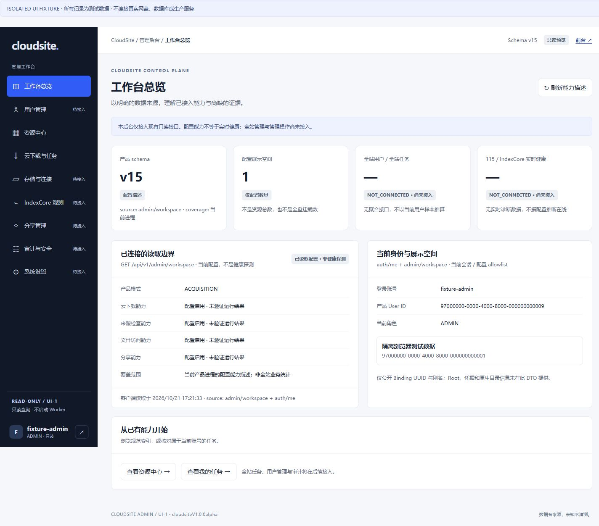
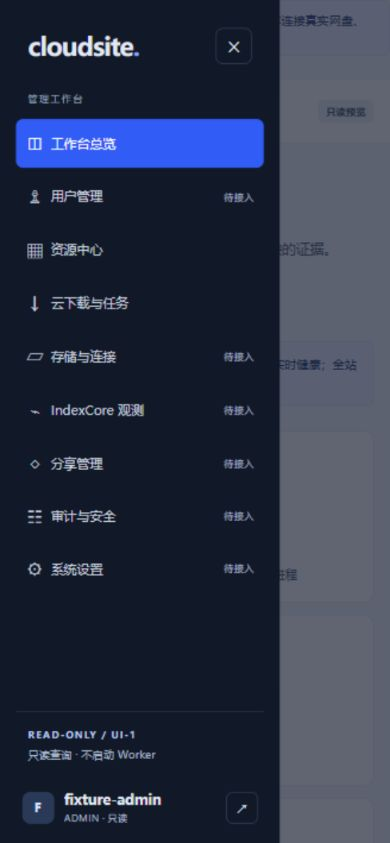
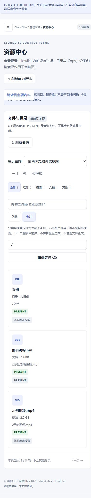

# Admin UI-1 — implementation and review handoff

2026-10-21 · Issue [143](https://github.com/nathanxiangang-web/cloudsite/issues/143)
· D-066 · **candidate for Architect review, NOT merged or deployed**.

Design PR142 baseline: `25eb7e28a12f452979a52e74cd3767f149f5df53`.
Its exact merged-main CI39570998775 was independently read before implementation:
all3 jobs completed SUCCESS. Issue141 is closed. This document does not authorize
UI-2/3/4, D-065 / paused139, production changes or a new provider task.

## Implemented

- Nine local navigation destinations, 232px dark desktop rail, breadcrumb,
  account/logout, narrow-screen modal drawer and an isolated admin-only stylesheet.
  Navigation does not claim server-side `/admin/*` deep-link routes.
- Overview uses only `GET /api/v1/admin/workspace` and `GET /api/v1/auth/me`.
  Schema, configuration flags, configured Binding count/UUID/label and current
  identity are real response fields. Flags mean **configured**, not online.
  Global users/tasks, real115/IndexCore health remain **NOT_CONNECTED / —**.
  Client read time and coverage/source labels are not server observation time.
- Resources reuse Q4 paged browse and Q5 exact resolve through existing product
  read APIs. Keep Binding allowlist, parent/back navigation, cursor, local-only
  category/search, list/card layouts and stable Resource/Copy identities.
  Optional Asset/Release/Variant fields show only when supplied; Root ID is
  explicitly unavailable in the current Resource DTO, not inferred from Binding.
- Downloads distinguishes unavailable **global tasks** from live **My Tasks**.
  Existing owner-only list/detail preserve Manifest/Job labels, claim/failure
  counters, result Copy and cursor. Detail renders an explicit DTO field allowlist,
  not arbitrary JSON/source/provider references or an invented progress timeline.
- Users/storage/IndexCore/shares/audit/settings show explained missing interfaces
  and disabled actions. None requests a proposed admin endpoint.
- Loading, genuine empty response, failure and stale same-page data are distinct.
  Failed refresh does not replace old facts with zero. Changing resource scope or
  task page clears the previous page rather than presenting it as the new scope.

## Modules / dependency direction / extension contract

| Boundary | Responsibility | Allowed dependency |
| --- | --- | --- |
| `web/index.html` | Semantic admin shell, local panel destinations, missing-capability states | Existing embedded static routes |
| `web/app.css` | Admin-only tokens, desktop/tablet/mobile layout and focus visuals | No consumer stylesheets |
| `app.js` session/transport functions | Generation fence, cancellation, same-origin no-store reads and existing login/logout | Existing auth + RoleAdmin workspace API |
| `app.js` view functions | Allowlisted overview/resource/task fields, local state and detail focus | Accepted product DTOs + unchanged ResourceDisplay |
| `app.js` navigation/drawer functions | Panels, active navigation, keyboard loop and focus return | View/session interfaces; no domain writes |
| `test/admin-dom.cjs` | Dependency-free DOM/fetch boundary for race assertions | Test-only fixtures, never embedded |
| `test/admin-preview.cjs` | Loopback ephemeral browser fixture, explicit synthetic-data banner | Test data only; no DB, credentials or real external services |

The small embedded UI stays framework-free; session, transport, navigation and
render functions are separated and independently exercised through the DOM
boundary. Future backend integration must introduce its own authorized,
server-enforced minimal DTO, then replace only the corresponding missing panel.
Do not add guessed API calls, browser SDK/SQL, scans, cross-user data fallbacks,
unbounded root traversal or management commands to these presentation functions.

## Authorization and race behavior

Server `RoleAdmin` enforcement is unchanged, not replaced by a UI role check.
Before ordinary resource/task reads, the shell revalidates the protected admin
descriptor and current principal. Cross-user Task ownership remains server policy,
including ADMIN callers. A changed principal or role, observed401/403, or logout
clears private rows/details/overview and aborts outstanding requests. Every response
checks the captured session generation; list/detail request counters also fence
out-of-order navigation/selection. A late401 from an old generation cannot log out
a new session. Logout clears the UI immediately, even before server acknowledgement.

Focus/visibility return and navigation/explicit refresh revalidate authorization;
there is **no server-push role/session revocation notification**. The client cannot
claim instantaneous knowledge of a role change before a server response. Domain
authorization is always decided by the server on each API request.

Drawer: labeled modal, background inert, backdrop/Escape close, Tab/Shift-Tab
containment, focus returned to menu control, desktop resize cleanup. Resource/task
details are inline read-only panels, not the future full incident drawer. Close/
Escape restores the trigger focus. No framework or inline script bypasses CSP.

## Tests

Executed on this candidate, not inferred from baseline CI:

- Windows Node: `node --test test/resource-display.test.cjs test/file-library.test.cjs test/cloud-download.test.cjs test/admin-ui.test.cjs`
  — **71 passed,0 failed,0 skipped**;14 new admin scenarios, existing consumer
  playback/share/download/login/deletion-view regressions retained.
- .50 isolated Go1.27.1 container: `go test ./... -count=1`,
  `go test -race ./... -count=1`, `go vet ./...`,
  `go build ./cmd/panta ./cmd/panta-db ./cmd/panta-staging` — exit0.
  Architecture import guard is included in full unit/race runs.
- .50 owned disposable PostgreSQL16 and18, separate network-none containers and
  tmpfs databases. PG16 `go test ./internal/store/postgres -run 'Test(Postgres|GateZero)' -count=1`
  — PASS15.788s; PG18 `-run TestPostgres` — PASS16.515s. No production database,
  provider connection or real OpenList instance used.
- New Go HTTP tests verify fresh role downgrade/regrant/revocation, no-store/
  redaction, nine static destinations, consumer asset separation and absence of
  future admin read/write routes. Existing product tests prove cross-owner ADMIN
  task rejection and sensitive-source redaction.
- Linux .50 `readonly_catalog_service_test.py`:11 PASS. Windows
  `deployment_safety_test.py`:3 PASS. The readonly Linux permission tests cannot
  run on Windows (`os.getuid` absent); the Linux archive-only source snapshot
  cannot run the Git-archive deployment test without `.git`. These environment
  limitations were not bypassed; each suite passed in its suitable environment.
- `git diff --check` — PASS.
- CI includes the new admin DOM suite alongside historic tests. Exact PR-head
  CI, including PostgreSQL16/18 controlled observation/Hint E2E and migrations,
  must be read on the submitted PR; see PR status/evidence. Baseline CI is not
  claimed as candidate CI. The Issue remains OPEN until review/merge/main CI.

New DOM coverage includes nine destinations, no future API requests, anonymous/
USER/admin403/non-JSON401 denial, six-character auth contract, immediate logout,
initial/login/late-error generation races, account switch/downgrade, stable IDs,
Binding/parent/cursor, local categories, empty/loading/error/STALE, late Q5/list/
task details, explicit task field allowlist, disabled controls and drawer focus.

## Evidence — rendered browser review

Real browser execution against the **isolated synthetic fixture**, not screenshots
of production or evidence of live115/IndexCore integration. The banner is added
only by the test server; production assets contain no fixture records.

Run `node test/admin-preview.cjs`; it prints a random loopback-only URL.
Open that exact `/admin/` URL. Stop the owned Node process when finished.

Reviewed1440×1000 desktop,1024×900 tablet and390×844 mobile:
overview, resources/list-card/detail, own tasks, nine-item navigation, drawer
open/close, Escape focus return and real bidirectional Tab loop. Read-only DOM
checks confirmed document width never exceeded those viewports; mobile tables
scroll within their container. Console warnings/errors: none observed.

Browser fixture uses pre-authenticated synthetic ADMIN data; actual credential
login, denial and revocation are covered by DOM/HTTP/PostgreSQL tests, not
misrepresented as browser-to-production authentication acceptance.

## Known limitations

- No global users/jobs/statistics, provider health/capacity, Root/Q8 diagnostics,
  admin shares, durable audit model, settings writes or full incident timeline.
- No admin file preview/download/share action: explicitly disabled here;
  existing consumer implementations remain unchanged and are not declared absent.
- No global resource search/full-root scan. Counts are current-page only.
- New tab reload starts at overview; no deep-link/history persistence yet.
- Desktop/mobile visual and keyboard review is not an independent screen-reader
  or exhaustive WCAG audit. UI-1 is not full admin/MVP production acceptance.

## Untouched / rollback boundary

Consumer `/`, `/downloads/`, their controllers/styles/player/share/302/CDN,
ResourceDisplay, backend services/authorization/routes, auth TTL, quotas,
schema15/migrations, acquisition/job/provider states, credentials, native115,
OpenList, IndexCore, production113.20.6.57 and paused D-065 are unchanged.
No production access, download, file mutation, service restart or deployment.
Only owned test containers/fixture processes are created for validation.

Rollback is a Git revert of the UI-1 commit; no data rollback/migration is needed.
Do not deploy this candidate without the separate review/deployment decision.

## Proposed UI-2 (NOT AUTHORIZED)

Separate Issue/design for server-enforced, redacted, paged admin-wide read models:
users, cross-user task summary, storage and bounded IndexCore diagnostics.
Specify identity/coverage/observed time/UNKNOWN, negative authorization tests,
secret-free fields and module ownership before replacing any placeholder.
No automatic progression to write operations, AI or private UserSpace.
