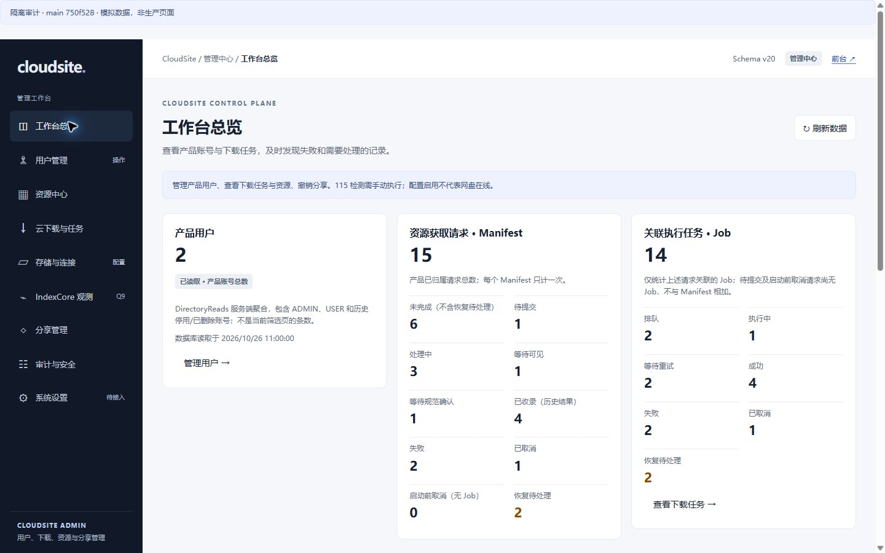
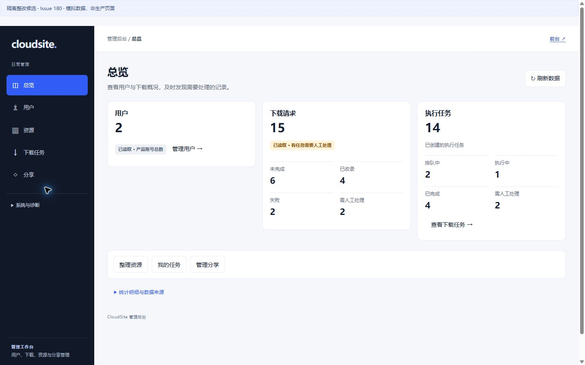
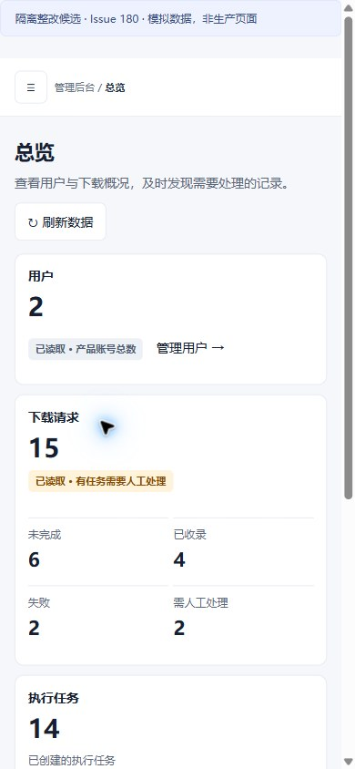

# Admin UI #180: screenshot audit and implementation

## Scope and evidence

The base is merged main `750f5281217d92bc2ed48b71bb28256bd0101e82`. Its push-main CI run40652403381 succeeded in all three jobs before implementation. This branch changes presentation and UI focus only. It does not modify database migrations, backend handlers or DTOs, command semantics, provider calls, IndexCore or production deployment. Production remains tracked separately in #153.

Open [comparison.html](comparison.html) for12 before/after pairs and4 interaction captures, or inspect the native JPEG files directly. **Every screenshot is an isolated synthetic fixture, not production.** Desktop CSS viewport1440x900; mobile390x844. Actual raster sizes and SHA256 values are in [evidence-manifest.json](evidence-manifest.json). Image16 uses native viewport capture, with raster1425x891 while its CSS viewport was1440x900. No images were edited.

The [top10 findings](before-audit.md) were recorded from freshly saved and inspected screenshots before frontend changes. The same synthetic users/resources/downloads were used for paired states; only interaction captures14-16 mutate an in-memory test resource.

## Modules and dependencies

| Module | Responsibility | Dependency boundary |
|---|---|---|
| index.html + app.css | Existing shell, five daily destinations, secondary diagnostics, native disclosures and responsive lists | Existing IDs and semantic form/table controls; no framework or asset pipeline changes |
| app.js | Composition root and pure DOM presentation ports (`present`, `rowLabels`, business labels) | Explicitly injected into existing controllers; textContent only, no HTML injection or new transport |
| admin-lists / observe / overview | Human list summaries with expandable provenance and identifiers | Existing verified reads, aggregation validation and stale/error distinctions |
| admin-audit / shares / operations | Business results with raw evidence retained in details | Existing action/result allowlists and actor/session/Binding fences |
| admin-pending-cancel / resource-editor | Existing confirmed actions, locked uncertainty and original-request reconciliation | Existing CAS, one-shot command, freshness and GET-only recovery contracts |

Identity formatting is explicit by DTO field. A file name that happens to resemble a UUID remains a visible business name. No generic string-shape guessing is used to hide content.

The resource editor now records the form submitter before busy controls disable it, then restores that element on dismissal. Receipt display state remains local to one operation and is re-rendered without flattening its disclosure after the authoritative reread. Neither change alters command authorization, payloads or state transitions.

Extension constraints: keep pure presentation ports independent of HTTP and storage; add no ad hoc endpoints, unsafe HTML or inferred fields; retain original IDs/codes in accessible details; keep context-specific action guardrails next to the action. A new business operation requires its own approved contract, not a new button wired into this cleanup.

## Validation

- `node --test test/*.test.cjs`:201 passed. Existing security/concurrency/reconciliation assertions remain; presentation assertions were updated only where intentional labels/placeholder removal changed.
- `go test ./internal/producthttp`: passed, including static asset isolation and safe primitive guards.
- Chrome: desktop/mobile screenshots; navigation Enter toggle and Escape restoration; selected-user focus and enabled controls; confirmation dismissal returns focus to `resource-edit-prepare`; synthetic503 locks editing; original-request GET recovers a confirmed receipt and exact resource reread.
- Desktop task table width1127px equals its container. At390 CSS pixels, clientWidth375 and scrollWidth375 on tested resource/download states; no whole-page horizontal overflow.
- Full CI for this PR must be checked against its exact head. Local tests are not a deployment claim.

## Limits and release

This is not a full WCAG certification or a test of every device/screen reader. Screenshots do not establish provider health. No real user management write, real115 call or production mutation was performed for this audit. Production read-only inspection still reports `cloudsite:users-ui-a790baca`; the earlier schema20 verification is a separate release receipt. Code review/CI and actual production validation remain distinct under #153. Reverting this UI commit restores the previous presentation without a data migration.

## Selected visual comparison (isolated fixtures)

| Main750f528 before | UI180 candidate after |
|---|---|
|  |  |
|  |  |
