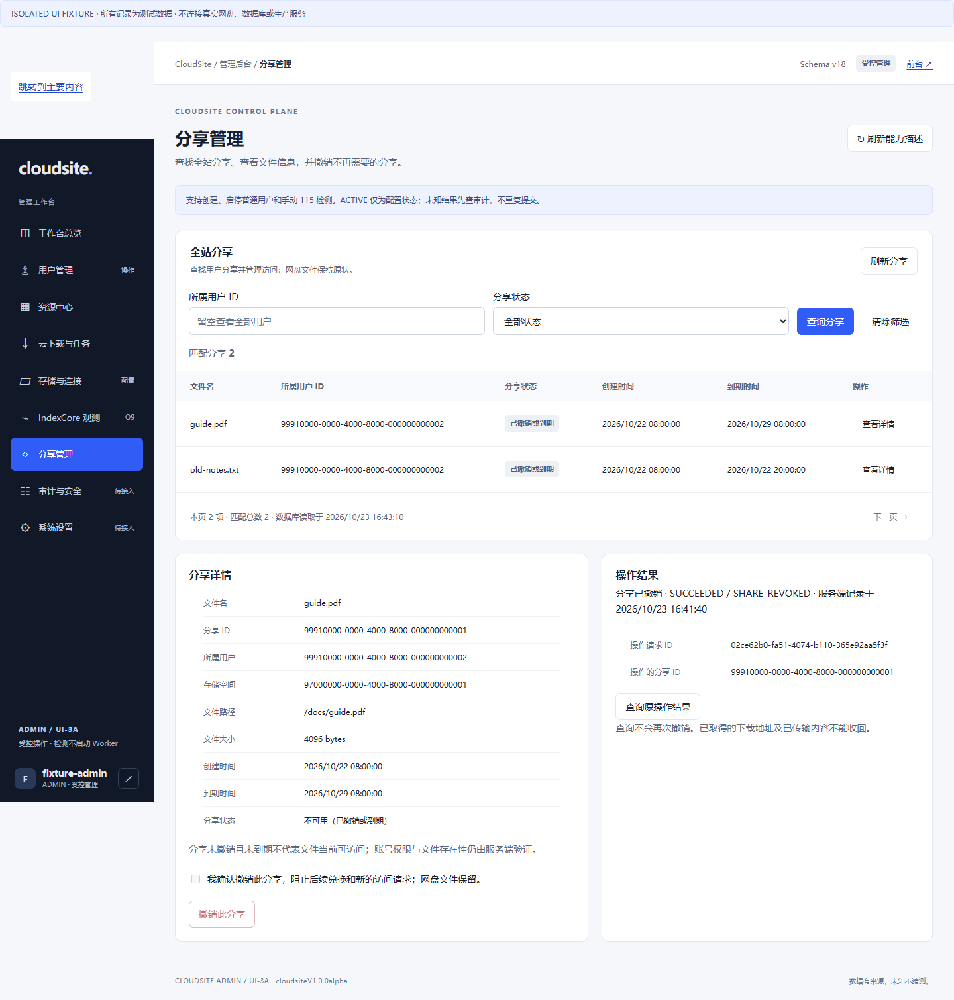
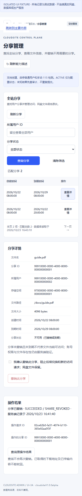

# Admin shares UI - isolated validation, 2026-10-23

Base:main205c28e6619e (PR161 backend merged; main CI39923298349 SUCCESS).
Scope:Issue155 PR-D2 share listing/filtering/keysets/details and explicit revoke.
No business API, schema, provider or production change. Acceptance follows the
actual implementation PR/exact-head CI, not this evidence document alone.

## Automated evidence

- The Node behavior suite covers real DTOs, owner/status filters, server totals,
  keysets, empty/failure/stale states, malformed pages/IDs, literal rendering,
  confirmation, exactly one POST, strict receipt identity/action/status/code,
  UNKNOWN/404/timeout handling, same-actor reload and different-actor isolation,
  logout/navigation/newer-read fencing, and no command on focus/visibility.
- The Go fixture test compares the JSON consumed by Node with an actual
  `adminread.ShareDirectory` value. Static asset tests use the actual Go handler
  to check embedding/serving and the reviewed list/revoke/status routes.
- The existing resource-display harness now loads the new module just as the
  page does. Old navigation tests only remove shares from the placeholder list
  because it is actually implemented; audit/settings remain placeholders.
- The existing physical-file deletion guard remains unchanged. No USER mutation
  receipt validator, database migration or provider code was widened.

## Real-browser fixture inspection

Used the Playwright CLI skill and an isolated Chrome session against
`node test/admin-preview.cjs --share-review --share-uncertain`, bound to an
ephemeral127.0.0.1 port. The page labels all data as synthetic. This is NOT the
production site, real-account/share validation, or a production deployment.

Observed desktop1440x1000 and mobile390x844:

1. Share navigation reads the actual DTO-shaped list and opens literal details.
2. Explicit confirmation sends one synthetic revoke POST. The fixture deliberately
   returns503 after recording a synthetic terminal result, emulating lost response.
3. UI marks the operation unconfirmed and disables further revoke. Reload retains
   the actor-scoped original request/target IDs without a second POST.
4. Explicit original-action GET returns SUCCEEDED/SHARE_REVOKED; the list refreshes
   and the inactive share cannot be revoked again. Browser request log contains
   one revoke POST and the later action GET, not an automatic POST retry.
5. Mobile uses stacked detail/result panels and an internally scrollable table.
   `document.body.scrollWidth` was390 at a390px viewport (no page-wide overflow).

One initial fixture favicon404 and the deliberately injected503 were observed;
neither is a product JavaScript exception. The fixture now serves favicon204.
Screenshots illustrate the isolated fixture layout/reconciled result, not proof
of a production operation or a replacement for exact-head automated tests.

## Operator boundary

On.50, only a new owned source/build directory is used; no existing service,
credential, shared database or container is changed for this frontend slice.
All18 migration files and the share backend remain unchanged. Production rollout
still requires the separate release workflow. AI/private UserSpace and paused
cloud-download troubleshooting are outside scope.
